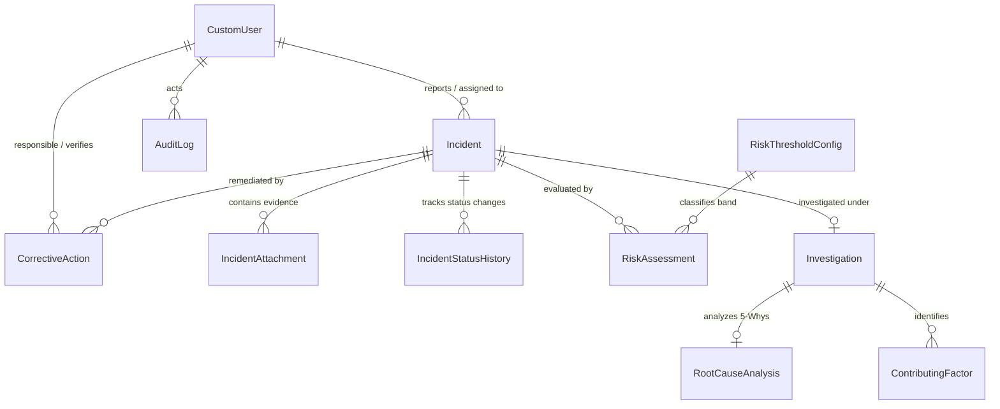

# SkyShield: Aviation Safety & Incident Reporting System

[](https://www.python.org/)
[](https://www.djangoproject.com/)
[](https://www.mysql.com/)
[](https://getbootstrap.com/)
[](#license)

> **IMPORTANT NOTICE:** SkyShield is an educational, demonstration, and portfolio web application modeled on international aviation safety frameworks (ICAO Annex 13, Doc 9859 Safety Management Manual, and FAA 14 CFR Part 5). It is designed to illustrate safety management software architecture and is **not certified for live airline flight dispatch, aerodrome air traffic operations, or regulatory airworthiness directives**.

---

## 1. Project Overview

**SkyShield** is a full-stack aviation safety management and incident reporting platform. Built with Python, Django 5.x, MySQL 8.x, and Bootstrap 5.3, SkyShield provides aviation organizations with a structured workflow to report safety occurrences, calculate objective risk scores using a 5&times;5 matrix, conduct formal safety investigations with structured 5-Whys Root Cause Analysis (RCA), assign and monitor Corrective and Preventive Actions (CAPA), and generate executive compliance reports and PDF dossiers.

---

## 2. Key Features

- **Role-Based Access Control (RBAC):**
  - **Reporter:** Submit occurrences and hazards, track personal submissions, view status.
  - **Investigator:** Lead safety inquiries, log factual findings and reviewed telemetry, conduct 5-Whys root cause analysis, track assigned CAPAs.
  - **Safety Manager:** Triage incidents, review risk classifications, assign investigators and CAPAs, enforce closure restrictions, approve investigations, view full analytics and audit logs.
  - **Administrator:** Configure risk band thresholds, manage users and roles, access Django Admin, monitor immutable audit logs.
- **Incident Reporting Engine:**
  - Auto-generated cryptographically unique reference codes (`SKY-YYYY-XXXXX`).
  - Standardized aviation occurrence categories (Runway Incursions, Bird Strikes, Maintenance Discrepancies, Equipment Failures, Ground Handling Accidents, Human Factors, Near Misses, Proactive Hazards, Procedure Deviations).
  - Secure file upload for flight data recorder (FDR) charts, photos, and maintenance orders with extension whitelisting and 10 MB size limits.
  - Server-side search, filtering (category, severity, status, date range), sorting, and pagination.
- **Configurable 5&times;5 Risk Assessment Matrix:**
  - Likelihood (1–5) &times; Severity (1–5) calculation strictly enforced on the server.
  - Configurable risk threshold bands (Low: 1–4, Moderate: 5–9, High: 10–15, Critical: 16–25) stored in MySQL for dynamic administrative tuning.
  - Interactive visual coordinate grid highlighting the incident's risk level.
- **Investigation & 5-Whys Root Cause Analysis (RCA):**
  - Structured investigation workspace tracking scope, objectives, factual findings, and evidence reviewed.
  - 5-Whys analysis drilling from the direct event trigger down to latent systemic organizational failures.
  - Multi-category contributing factor tracking (Human, Environmental, Organizational, Technical, Aerodrome).
  - Safety Manager review and approval gate.
- **Corrective & Preventive Action (CAPA) Tracking:**
  - Assignment of time-bound mitigations with priorities (Low, Medium, High, Critical).
  - Real-time automated overdue detection.
  - Two-stage workflow: Assignee submits implementation evidence &rarr; Safety Manager audits and verifies completion.
  - **Strict Closure Gate:** Incidents cannot be closed while required investigations or open CAPAs remain incomplete (with optional manager exception override).
- **Executive Safety Dashboard & Analytics:**
  - Real database KPIs: Total incidents, current month count, active cases, high/critical risk count, in-progress investigations, overdue actions.
  - Interactive Chart.js charts: 6-month occurrence trend, category breakdown, severity distribution, lifecycle status distribution.
- **Compliance Reports & Exports:**
  - Filtered CSV exports for incidents, CAPA registers, and audit trails.
  - Formal aviation incident dossier PDF generation formatted for safety committee reviews.
- **Security & Regulatory Audit Trail:**
  - Immutable audit logging tracking logins, updates, risk re-evaluations, status overrides, and exports.
  - Protection against IDOR (Insecure Direct Object References), CSRF, XSS, and SQL injection.

---

## 3. Technology Stack

| Layer | Technologies |
|---|---|
| **Backend** | Python 3.13+ / 3.15, Django 5.x LTS, Django ORM, Django Forms |
| **Database** | MySQL 8.x (`mysqlclient` / `PyMySQL` driver with `utf8mb4` charset) |
| **Frontend** | HTML5, CSS3, Bootstrap 5.3, Bootstrap Icons, Chart.js 4.4 |
| **Reporting** | ReportLab 4.x (PDF generation) and Python CSV module |
| **Environment** | `python-dotenv`, Git, Windows PowerShell ready |

---

## 4. Database Schema Overview



---

## 5. Prerequisites

- **Python:** Python 3.13 or higher (verified compatible with Python 3.14 / 3.15).
- **MySQL Server:** MySQL 8.x installed and running on `127.0.0.1:3306`.
- **Git:** Git version control installed.
- **OS:** Windows 10/11 (PowerShell commands documented below).

---

## 6. Windows Installation & Setup Guide

### Step 1: Clone Repository & Open PowerShell

```powershell
cd C:\Users\Global\Desktop\skyshield
```

### Step 2: Configure Python Virtual Environment

```powershell
python -m venv .venv
.\.venv\Scripts\Activate.ps1
```

### Step 3: Install Required Dependencies

```powershell
pip install -r requirements.txt
```

*Package list in `requirements.txt`:*
- `Django>=5.1,<6.0`
- `pymysql>=1.1.0`
- `cryptography>=42.0.0`
- `python-dotenv>=1.0.1`
- `reportlab>=4.2.0`
- `Pillow>=10.3.0`

### Step 4: Configure MySQL Database

Open MySQL command prompt or MySQL Workbench and execute:

```sql
CREATE DATABASE skyshield_db CHARACTER SET utf8mb4 COLLATE utf8mb4_unicode_ci;
CREATE USER 'skyshield_user'@'localhost' IDENTIFIED BY 'skyshield_secure_password_2026';
GRANT ALL PRIVILEGES ON skyshield_db.* TO 'skyshield_user'@'localhost';
FLUSH PRIVILEGES;
```

### Step 5: Environment File Configuration

Copy `.env.example` to `.env`:

```powershell
Copy-Item .env.example .env
```

Edit `.env` to match your local MySQL configuration:

```ini
DJANGO_SECRET_KEY=skyshield-insecure-dev-key-change-this-in-production-10928374
DJANGO_DEBUG=True
DJANGO_ALLOWED_HOSTS=127.0.0.1,localhost

DB_NAME=skyshield_db
DB_USER=skyshield_user
DB_PASSWORD=skyshield_secure_password_2026
DB_HOST=127.0.0.1
DB_PORT=3306

# Set to True only if local MySQL is temporarily unavailable for offline unit testing
USE_SQLITE_DEV=False
```

### Step 6: Apply Database Migrations

```powershell
python manage.py migrate
```

### Step 7: Seed Realistic Aviation Demonstration Data

SkyShield includes an idempotent management command that seeds realistic flight occurrences, risk thresholds, users for all 4 roles, investigations with 5-Whys, and CAPAs:

```powershell
python manage.py seed_demo_data
```

**Pre-seeded Demonstration Credentials:**
All demo accounts share the password: `Password123!`

| Role | Username | Password | Purpose |
|---|---|---|---|
| **Administrator** | `admin` | `Password123!` | System config, user permissions, Django Admin |
| **Safety Manager** | `safetymanager` | `Password123!` | Triage, approvals, investigator assignment, closure |
| **Investigator** | `investigator` | `Password123!` | Workspace findings, 5-Whys RCA, CAPA actions |
| **Reporter** | `reporter` | `Password123!` | Incident and hazard submission |

### Step 8: Start the SkyShield Application Server

```powershell
python manage.py runserver 127.0.0.1:8000
```

Open your browser and navigate to:
- **Application Portal:** [http://127.0.0.1:8000/](http://127.0.0.1:8000/)
- **Django Admin Console:** [http://127.0.0.1:8000/admin/](http://127.0.0.1:8000/admin/)

---

## 7. Running Automated Tests

SkyShield includes unit and integration tests covering model calculations, unique reference generation, role access controls (IDOR prevention), workflow transitions, and closure restrictions:

```powershell
python manage.py test tests
```

---

## 8. Publishing to GitHub

To push the repository to GitHub:

```powershell
git add .
git commit -m "feat: complete SkyShield Aviation Safety & Incident Reporting System"
git remote add origin https://github.com/<your-username>/skyshield.git
git branch -M main
git push -u origin main
```

---

## 9. Security & Compliance Highlights

- **Server-Side Validation:** Risk scores and levels are computed server-side via `calculate_score_and_level()`. Client-side tampering cannot alter database values.
- **IDOR Protection:** Reporters can only view incidents they personally reported. Cross-account access attempts return an HTTP 403 Forbidden.
- **Closure Guard:** An incident cannot transition to `CLOSED` if active investigations remain unapproved or if any corrective action is outstanding, unless explicitly overridden and audited by a Safety Manager.
- **CSRF & Password Hashing:** Enforces Django CSRF protection across all forms and utilizes PBKDF2 with SHA256 password hashing.
- **Audit Logging:** Every login, logout, status change, risk assessment, and export is recorded in an immutable `AuditLog` table.
